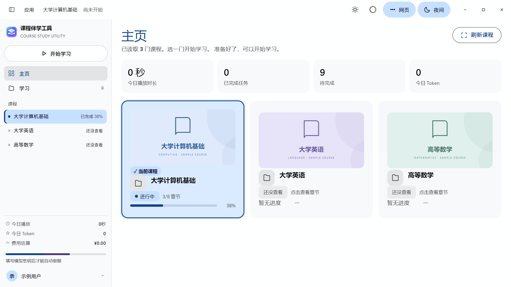
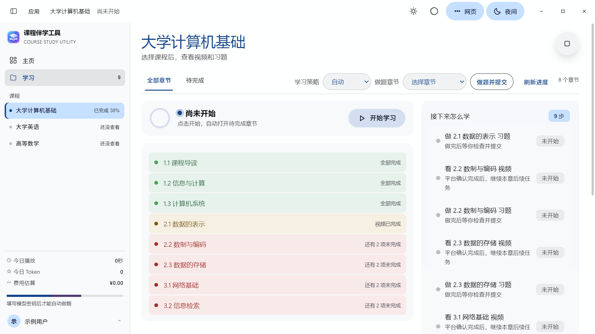

<div align="center">
  
  <h1>课程伴学工具</h1>
  <p>兼容学习通（超星平台）的 Windows 课程辅助工具。</p>
  <p>在一个窗口里选课、查看章节进度，安排视频与习题。<br>需要题目辅助时，在设置中填写自己的模型密钥。</p>
  <p>Windows 10 / 11 · x64 · 开源免费 · GPL-3.0-only</p>
  <p>
    <a href="https://github.com/Invariant-325/course-study-utility/releases/latest"><strong>下载最新稳定版</strong></a> ·
    <a href="CHANGELOG.md">查看更新日志</a> ·
    <a href="https://github.com/Invariant-325/course-study-utility/issues">反馈问题</a>
  </p>
  <p><sub>当前正式版：v0.2.7 · <a href="https://github.com/Invariant-325/course-study-utility/releases">测试版与历史版本</a></sub></p>
</div>

## 软件预览



<details>
<summary>查看学习工作区：章节状态与接下来要做的任务</summary>



</details>

<sub>真实 Electron 界面截图；隔离测试环境中的课程封面、名称和进度均为示例数据，不含个人账号。</sub>

## 用它做什么

**课程与进度**<br>
在主页找到课程，进入后读取章节目录。已读取的进度会保存在本地，回到主页也能接着查看。

**学习工作区**<br>
视频和习题分开显示，章节完成情况用颜色区分。选择学习策略后，可以看到接下来要处理的任务顺序。

**AI 题目辅助**<br>
调用模型读取题目截图，给出答案并填写。自动做题和自动提交分别控制，答案仍需自行核对。

**按你的习惯**<br>
切换明暗主题和配色，拖动侧栏调整宽度。需要平台原网页时，点顶部的“网页”即可打开。

**桌面常用操作**<br>
收进系统托盘、让课程网页静音，或开启夜间模式倒计时息屏。播放时长和模型调用统计也在应用里查看。

## 快速开始

1. [下载最新稳定版](https://github.com/Invariant-325/course-study-utility/releases/latest)，选择 `Setup-x64.exe` 安装程序。更新前先从系统托盘退出旧程序。
2. 启动应用，通过顶部“网页”入口按平台要求登录。课程要求刷脸时，用本人手机完成二维码验证。
3. 在主页选择课程，进入学习工作区，选择学习方式后开始。

需要 AI 功能时，点左下角头像进入**设置**，填写自己的 DeepSeek API Key。当前版本使用内置的模型服务。模型 API 费用由服务商收取，软件不捆绑付费模型订阅。

平台页面变化可能影响课程读取，暂未适配的操作可通过“网页”入口完成。

## 开发与开源

由 [Invariant-325](https://github.com/Invariant-325) 维护，使用 DeepSeek 与 Codex 辅助开发。桌面端使用 Electron，界面与课程脚本使用 JavaScript、HTML 和 CSS。

- [`desktop/`](desktop/)：桌面程序与界面，入口为 `main.js`，界面位于 `ui/`。
- [`userscript/`](userscript/)：课程页面脚本及构建入口。
- [`desktop/BUILD.md`](desktop/BUILD.md)：本地构建、离线依赖、打包与校验说明。

安装 Node.js 与 npm 后，在仓库根目录运行：

```powershell
cd desktop
npm ci
npm start
```

问题反馈到 [Issues](https://github.com/Invariant-325/course-study-utility/issues)，附上应用版本、复现步骤和报错。日志中的账号、API Key、Cookie 与登录参数须脱敏。

项目采用 [GPL-3.0-only](LICENSE)，分发修改版时需按许可证提供对应源码。

## 声明

本项目是兼容学习通（超星平台）的个人第三方工具，与相关平台不存在官方合作或授权关系。使用时需遵守平台规则及所属机构要求。

[许可证](LICENSE) · [开源声明](OPEN_SOURCE.md) · [免责声明](DISCLAIMER.md)
